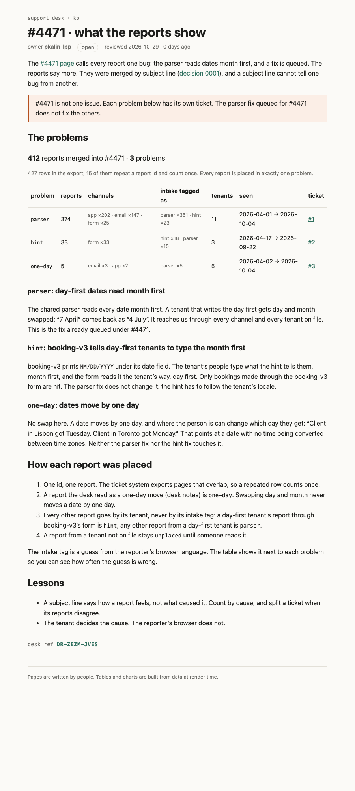

# The kb as the desk sees it

A static build of `src/` (SvelteKit + mdsvex, the `runbook` layout), made on 2026-10-29.

- New page: [`kb/incidents/4471/problems/index.html`](kb/incidents/4471/problems/index.html), source [`src/routes/kb/incidents/4471/problems/+page.svx`](../src/routes/kb/incidents/4471/problems/%2Bpage.svx)
- Screenshot of it: [`problems.png`](problems.png)

